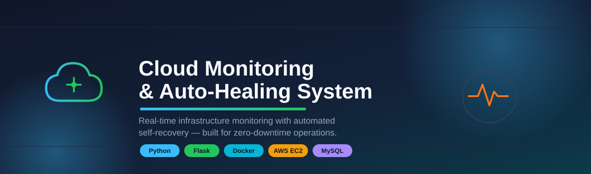
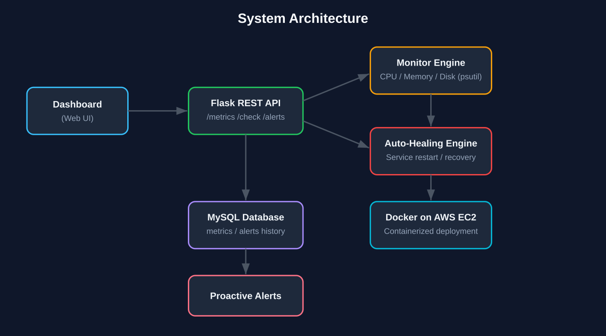
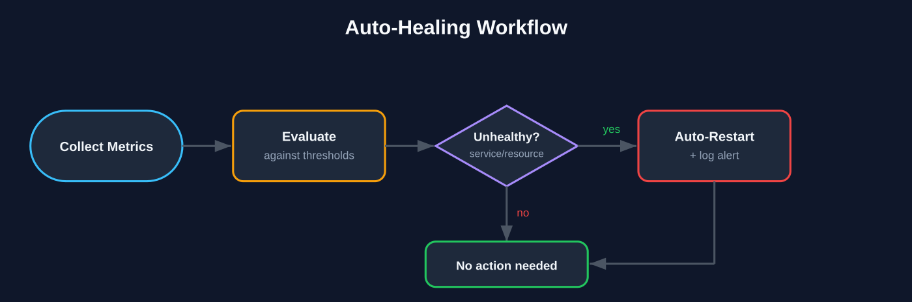
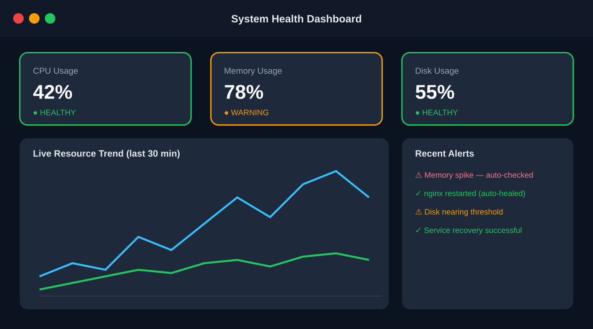

# Cloud Monitoring & Auto-Healing System

<div align="center">
  
</div>

<div align="center">


</div>

## Overview

The **Cloud Monitoring & Auto-Healing System** is a Python-based infrastructure monitoring application that collects system resource utilization, evaluates system health, and displays monitoring information through a web dashboard.

The application monitors CPU, memory, and disk utilization using Python's `psutil` library. It evaluates resource usage against predefined thresholds and identifies system conditions as HEALTHY, WARNING, or CRITICAL.

The application uses Flask to expose REST APIs and MySQL to store monitoring metrics and alert history. Docker and Docker Compose are used to containerize and manage the application and database.

I also extended the application by developing a web-based monitoring dashboard and implementing database-backed alert retrieval to make historical alerts available even after application restarts.

## Features

| Feature | Description |
|---|---|
| System Monitoring | Collects CPU, memory, and disk utilization using psutil. |
| Health Evaluation | Evaluates resource usage against predefined thresholds. |
| REST APIs | Flask APIs provide metrics, health checks, and alert information. |
| Monitoring Dashboard | Displays resource utilization, system status, and alert history. |
| Alert Management | Identifies resource-related issues and records alerts. |
| MySQL Persistence | Stores metric records and alert history in MySQL. |
| Docker Containerization | Runs the Flask application and MySQL database in separate containers. |
| Health Check Logic | Includes service health-check and restart logic for monitored services. |

## System Architecture

<div align="center">
  
</div>

### How the system works

1. **Metric Collection:** Python's psutil library collects CPU, memory, and disk utilization.
2. **Health Evaluation:** The monitoring component compares collected values against predefined thresholds.
3. **Backend Processing:** Flask provides REST API endpoints to retrieve metrics, execute health checks, and access alerts.
4. **Database Storage:** MySQL stores collected metrics and generated alerts.
5. **Dashboard Visualization:** The frontend retrieves information from Flask APIs and displays resource usage and alert history.
6. **Containerization:** Docker Compose manages the Flask application and MySQL database containers.

## Auto-Healing Workflow

<div align="center">
  
</div>

The application includes a basic health-check and service-recovery mechanism.

The workflow follows:

**Collect → Evaluate → Detect → Alert / Attempt Recovery**

- Resource utilization is evaluated against configured thresholds.
- High resource utilization generates a RESOURCE alert.
- The application contains logic to check monitored services and attempt a restart when a service is detected as stopped.
- Alerts are recorded for monitoring and troubleshooting.

**Implementation note:** Health checks are triggered through the API or dashboard button; a background scheduler is not currently implemented. The service restart mechanism has not been fully validated in the current Docker environment because the application container does not run systemd. High resource utilization currently generates alerts rather than automatically correcting the resource usage.

## Dashboard

<div align="center">
  
</div>

The web dashboard provides a visual interface for monitoring system health.

### Dashboard functionality

- Displays CPU utilization.
- Displays memory utilization.
- Displays disk utilization.
- Shows overall system health status.
- Displays recent alert history.
- Provides a Run Health Check button.
- Refreshes monitoring information periodically through Flask API requests.

**Note:** The image above is a design preview. Replace it with a screenshot of the running dashboard when available.

## Technology Stack

| Component | Technology |
|---|---|
| Programming Language | Python 3.11 |
| Backend Framework | Flask |
| System Monitoring | psutil |
| Frontend | HTML, CSS, JavaScript |
| Database | MySQL |
| Containerization | Docker |
| Container Management | Docker Compose |
| Version Control | Git and GitHub |

## Project Structure

```text
Cloud-Monitoring-Auto-Healing-System/
│
├── app/
│   ├── main.py              # Flask application and REST APIs
│   ├── monitor.py           # CPU, memory and disk monitoring
│   ├── auto_heal.py         # Health checks and service recovery logic
│   ├── db.py                # MySQL database operations
│   │
│   ├── templates/
│   │   └── index.html       # Monitoring dashboard
│   │
│   └── static/
│       ├── style.css        # Dashboard styling
│       └── script.js        # Dashboard API integration
│
├── assets/
│   ├── architecture-diagram.png
│   ├── auto-healing-workflow.png
│   ├── banner-hero.png
│   └── dashboard-mockup.png
│
├── Dockerfile
├── docker-compose.yml
├── requirements.txt
├── start.sh
├── .env.example
├── .gitignore
├── WORKING_PROCESS.md
├── LICENSE
└── README.md
```

## Getting Started

### Prerequisites

- Python 3.11+
- Docker Desktop
- Docker Compose
- Git

### 1. Clone the repository

```bash
git clone https://github.com/Anushkash26/Cloud-Monitoring-Auto-Healing-System.git
```

### 2. Navigate to the project directory

```bash
cd Cloud-Monitoring-Auto-Healing-System
```

### 3. Start the application

```bash
docker compose up --build -d
```

### 4. Verify running containers

```bash
docker compose ps
```

### 5. Access the application

Open the following URL in your browser:

```text
http://localhost:5000/
```

The Flask application and MySQL database are started through Docker Compose.

To stop the containers:

```bash
docker compose down
```

## REST API Reference

| HTTP Method | Endpoint | Description |
|---|---|---|
| GET | `/` | Displays the monitoring dashboard. |
| GET | `/api/health` | Checks Flask application health. |
| GET | `/api/metrics` | Collects and returns current system metrics. |
| POST | `/api/check` | Triggers a health check and generates alerts when required. |
| GET | `/api/alerts` | Retrieves recent alerts from MySQL. |

### Example API requests

Retrieve system metrics:

```bash
curl http://localhost:5000/api/metrics
```

Check application health:

```bash
curl http://localhost:5000/api/health
```

Trigger a health check:

```bash
curl -X POST http://localhost:5000/api/check
```

Retrieve alert history:

```bash
curl http://localhost:5000/api/alerts
```

## Monitoring Thresholds

The application uses predefined thresholds to evaluate system resource utilization.

| Resource | Threshold |
|---|---:|
| CPU | 85% |
| Memory | 90% |
| Disk | 90% |

The monitoring component classifies system health based on the configured evaluation logic:

- **HEALTHY:** Resource utilization is within normal limits.
- **WARNING:** Resource utilization is approaching configured limits.
- **CRITICAL:** A critical resource threshold has been exceeded.

## My Contributions and Learning

I extended an existing open-source monitoring project and worked on understanding and improving its functionality.

My contributions include:

- Developed a web-based monitoring dashboard using HTML, CSS, and JavaScript.
- Integrated the dashboard with Flask REST APIs.
- Updated alert retrieval functionality to fetch historical alert records from MySQL.
- Tested metric collection, health-check APIs, and database persistence.
- Configured and executed the application using Docker Compose.
- Practised troubleshooting application and database containers.

### Key Concepts Learned

- Infrastructure monitoring and resource utilization.
- REST API development using Flask.
- Python system monitoring with psutil.
- MySQL database integration and persistence.
- Docker images, containers, and Docker Compose.
- Basic health checks, alerting, and service recovery concepts.

## Future Improvements

- Implement continuous background health monitoring.
- Improve and validate automatic service recovery inside containers.
- Add email and Slack notifications for critical alerts.
- Integrate AWS CloudWatch for cloud infrastructure monitoring.
- Deploy the application on an AWS EC2 instance.
- Add Grafana for advanced monitoring and visualization.
- Support monitoring multiple servers.


## License

This project retains the original repository's MIT License. Refer to the [LICENSE](LICENSE) file for details.

---

<div align="center">

**Developed and extended by Anushka Shelke**

*Learning Cloud Engineering, Infrastructure Monitoring, and DevOps.*

</div>